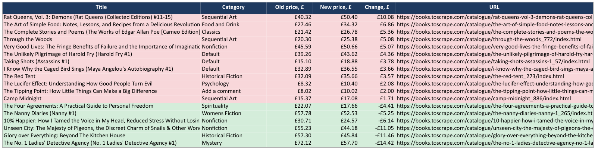

# Catalog price monitor

Scrapes an online catalog, keeps a snapshot between runs, and produces an Excel
report: summary by category with a chart, the full product list with filters,
price changes since the last run (red = up, green = down) and new products.

Demo target is [books.toscrape.com](https://books.toscrape.com), a sandbox site
built for scraping practice: 1,000 products across 50 categories. Adapting it
to a real store usually means rewriting two small parse functions.



*The sample report was generated after editing the previous snapshot, so the "Price changes" and "New products" tabs have something to show.*

## What it handles

- Pagination inside every category
- Retries with backoff on network errors, polite delay between requests
- Snapshot comparison: price changes and new listings
- Clean Excel output: frozen headers, filters, currency formats, chart

## Run

```bash
pip install -r requirements.txt
python monitor.py              # full catalog, ~1 minute
python monitor.py --limit 3    # first 3 categories, quick check
pytest                         # parser and comparison tests
```

Output goes to `output/`: `catalog_report_YYYY-MM-DD.xlsx` and `last_snapshot.json`.
Run it on a schedule (cron, Task Scheduler, GitHub Actions) and the
"Price changes" tab becomes a daily diff.
